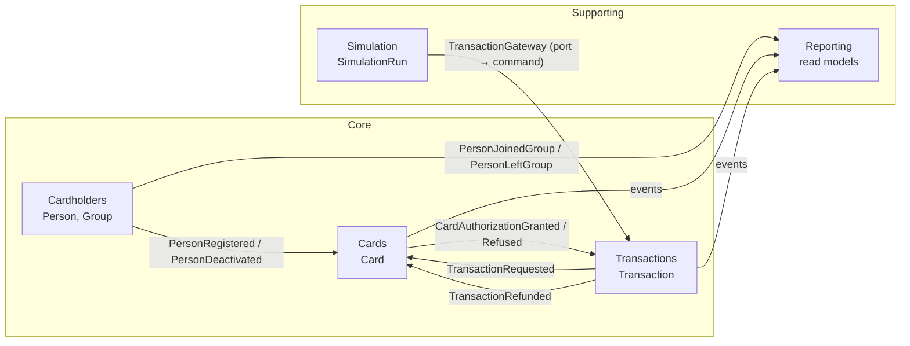

# 02 — Bounded contexts

## Context map

| Context | Type | Responsabilité | Agrégats |
|---|---|---|---|
| **Cardholders** | Core | Identité des personnes, groupes et appartenance | `Person`, `Group` |
| **Cards** | Core | Émission des cartes, statut, plafond, encours, décision d'autorisation | `Card` |
| **Transactions** | Core | Cycle de vie d'une transaction | `Transaction` |
| **Simulation** | Supporting | Génération de demandes de transaction fictives | `SimulationRun` |
| **Reporting** | Supporting (read only) | Projections dénormalisées pour l'UI | aucun (read models) |

Il n'y a pas de context d'identité : l'app n'a pas d'authentification ([ADR-0006](../adr/0006-no-authentication.md)).

## Relations

- **Cardholders → Cards** (*publisher / subscriber*). Cards tient sa propre projection locale `cardholders` (id + statut), alimentée par `PersonRegistered` et `PersonDeactivated`. Cards n'appelle **jamais** Cardholders de façon synchrone. Avantage : si Cardholders change son modèle, Cards n'est pas impacté (couche anti-corruption dans le handler d'event).
- **Transactions ↔ Cards** (*saga d'autorisation* par events, voir [transactions.md](transactions.md)). La décision « la carte peut-elle payer ? » appartient à `Card`, qui détient l'invariant de plafond. `Transaction` porte le cycle de vie.
- **Simulation → Transactions** (*customer / supplier*). Simulation passe par le port `TransactionGateway`. L'adapter in-process appelle la commande `RequestAuthorization` du context Transactions. On pourrait le remplacer par un client HTTP sans toucher Simulation.
- **Reporting** consomme les events de tous les contexts et ne publie rien.
- **Shared kernel** (`apps/api/src/shared/domain`) : `Money`, `Currency`, `Entity`, `AggregateRoot`, `DomainEvent`, `DomainError`, ids typés. Il doit rester très petit.

## Règles de couplage

1. Un context n'importe de l'extérieur que le `shared kernel` et les **contrats d'events** publiés (`<context>/contracts/*.event.ts`). Ces contrats sont des types de payload versionnés, pas les classes du domaine.
2. Aucune clé étrangère SQL entre les tables de contexts différents, même si la base est la même. Les références sont des ids opaques.
3. Chaque context a son module Nest racine et son schéma Postgres dédié (`cardholders`, `cards`, `transactions`, `simulation`, `reporting`).
4. La règle est vérifiée par `dependency-cruiser` en CI (voir [08-conventions.md](../08-conventions.md)).
