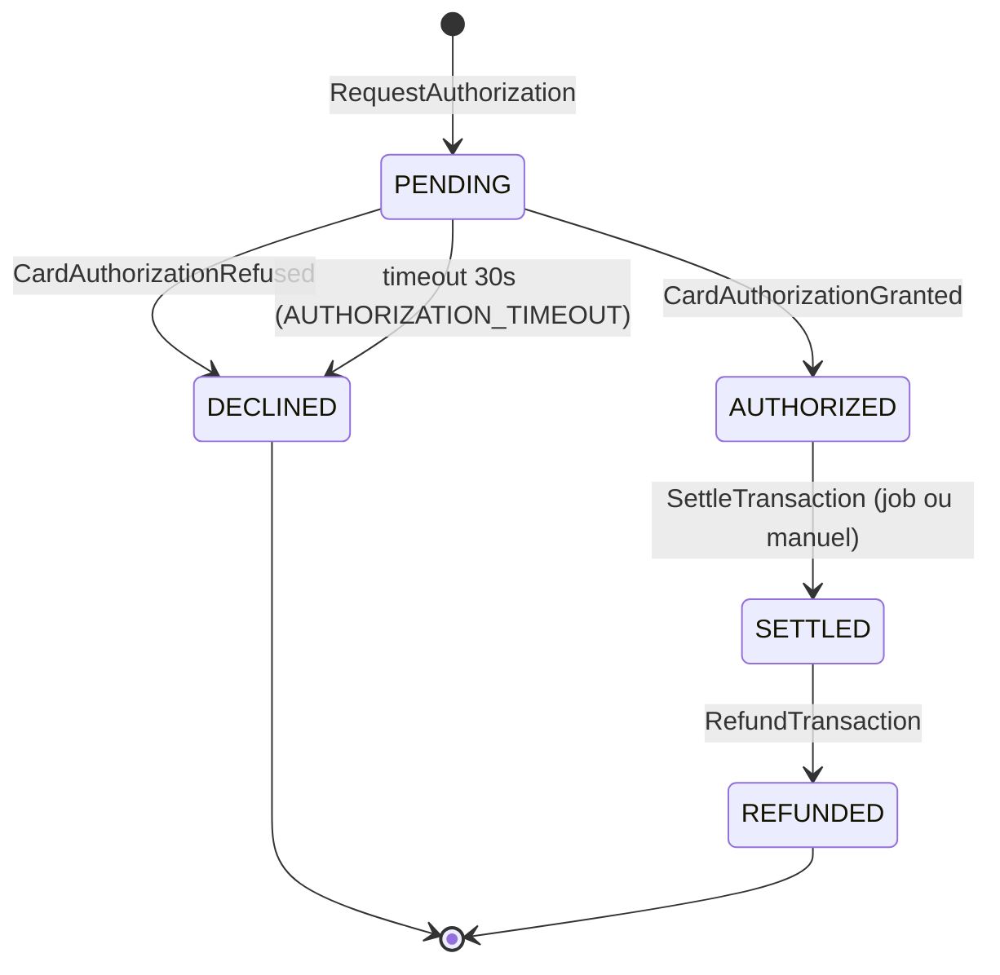
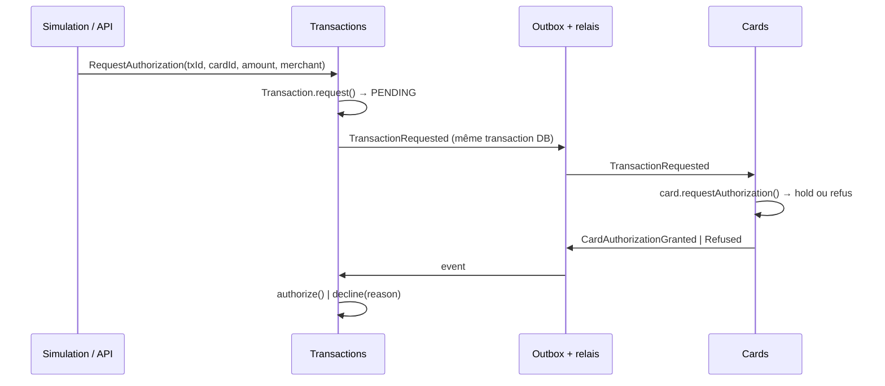

# Context Transactions

Porte le **cycle de vie** d'une transaction. La décision d'autorisation est déléguée à Cards via une saga par events.

## Agrégat `Transaction`

| Attribut | Type | Notes |
|---|---|---|
| `id` | `TransactionId` | fourni par l'appelant (idempotence) ou généré |
| `cardId` | `CardId` | |
| `amount` | `Money` | > 0, ≤ 10 000 € par transaction |
| `merchant` | `Merchant` (VO) | `{ name, category: MerchantCategory, country: ISO-3166 alpha-2 }` |
| `status` | voir le diagramme | |
| `declineReason` | `DeclineReason \| null` | obligatoire si `DECLINED`. Reprend les motifs de Cards (via le contrat d'event) et ajoute `AUTHORIZATION_TIMEOUT`, propre à Transactions |
| `requestedAt`, `authorizedAt`, `settledAt`, `refundedAt` | `Date \| null` | |
| `source` | `MANUAL \| SIMULATION` | + `simulationRunId?` |
| `version` | `number` | |

## Cycle de vie

**Invariants**
- T1 : les transitions respectent strictement le diagramme. Toute autre transition lève `InvalidTransactionTransition`.
- T2 : `DECLINED` a toujours un `declineReason`.
- T3 : un remboursement porte sur le **montant total** (pas de remboursement partiel dans la v1).
- T4 : les transitions déclenchées par des events sont idempotentes. Recevoir `CardAuthorizationGranted` sur une transaction déjà `AUTHORIZED` ne fait rien.
- T5 : les horodatages sont croissants (`requestedAt ≤ authorizedAt ≤ settledAt ≤ refundedAt`).

## Saga d'autorisation

- Chaque étape modifie **un seul agrégat** dans **une seule transaction DB**.
- **Timeout** : le job `ExpirePendingTransactions` (toutes les 10 s) passe en `DECLINED(AUTHORIZATION_TIMEOUT)` les transactions `PENDING` depuis plus de 30 s. Si un `Granted` arrive après un timeout, Transactions publie `TransactionAuthorizationCompensationRequired`. Cards réagit avec `release()` : c'est la compensation.
- **Règlement** : le job `SettleAuthorizedTransactions` règle les transactions `AUTHORIZED` depuis plus de N secondes (configurable, 60 s par défaut). L'opérateur peut aussi régler manuellement.

## Commandes

`RequestAuthorization`, `ApplyAuthorizationDecision` (interne, déclenchée par un event), `ExpirePendingTransactions`, `SettleTransaction`, `RefundTransaction`.

## Events émis

`TransactionRequested`, `TransactionAuthorized`, `TransactionDeclined`, `TransactionSettled`, `TransactionRefunded`, `TransactionAuthorizationCompensationRequired`.

## Erreurs métier

`TransactionNotFound`, `InvalidTransactionTransition`, `InvalidAmount`, `TransactionAlreadyExists` (même id, payload différent).
