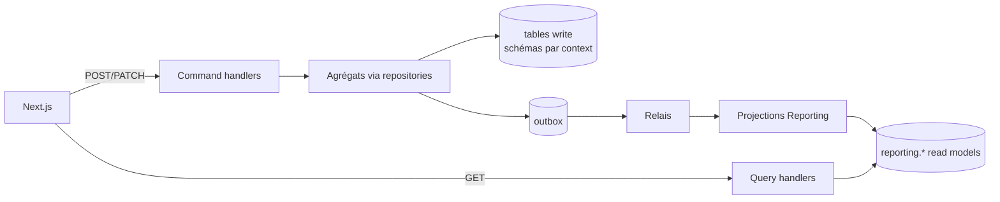

# CQRS

## Principe

| | Write side | Read side |
|---|---|---|
| Entrée | `Command` (intention, impératif : `IssueCard`) | `Query` (`GetCardDetails`, `ListTransactions`) |
| Passe par | agrégat + repository + UnitOfWork | SQL direct sur des read models dénormalisés |
| Retour | `void` ou l'id créé | DTO de lecture prêt pour l'UI |
| Modèle | riche, avec les invariants | plat, sans comportement |
| Cohérence | forte, dans l'agrégat | **éventuelle** (latence de quelques centaines de ms) |

- Une **query ne charge jamais un agrégat**. Une **commande ne lit jamais un read model** pour décider. Seule exception tolérée : les ports de lookup en lecture, dans le même context (`PersonLookup`), qui lisent les tables write du context.
- Les query handlers vivent dans `reporting/application/queries`. Leur port `TransactionReadModel` est implémenté en SQL dans `reporting/infrastructure`.

## Read models (schéma `reporting`)

| Table | Contenu | Alimentée par |
|---|---|---|
| `rm_transactions` | une ligne par transaction : statut, montant, marchand, catégorie, carte (PAN masqué), personne (nom), groupe (nom), horodatages | events `Transaction*`, `Card*`, `Person*`, `Group*` |
| `rm_cards` | carte + titulaire + plafond, encours, disponible, statut | `Card*`, `Person*` |
| `rm_people` | personne + groupe + nombre de cartes + total dépensé | `Person*`, `PersonJoinedGroup`, `CardIssued`, `TransactionSettled/Refunded` |
| `rm_groups` | groupe + nombre de membres + total dépensé | `Group*`, `PersonJoined/LeftGroup`, `Transaction*` |
| `rm_daily_stats` | agrégats par jour, catégorie et statut | `Transaction*` |
| `rm_simulation_runs` | état des simulations | `Simulation*` |

Les projections sont **idempotentes** : upsert par clé, et la `aggregateVersion` de la ligne est comparée à celle de l'event pour ignorer les events en retard ou rejoués.

**Reconstruction** : la commande CLI `pnpm --filter api projections:rebuild <name>` vide la table et rejoue l'outbox archivée. L'outbox est conservée, ce qui fait d'elle un journal d'events.

## Cohérence éventuelle côté UI

- Après une commande, l'API renvoie l'id (ou `204`). La server action relit le read model jusqu'à y voir l'effet attendu (`readYourWrite`, `apps/web/lib/api/consistency.ts` : toutes les 100 ms, 2 s au plus), puis redirige ou rafraîchit la page. Au-delà du délai, la page affiche l'état connu, sans erreur.
- Une projection qui dépend d'une ligne d'un autre agrégat pas encore projetée (ex. `PersonJoinedGroup` avant `PersonRegistered`) lève `ProjectionNotReadyError` : le relais rejouera l'event.
- Pour les transactions, l'état `PENDING` est affiché explicitement et le flux SSE fait la mise à jour.

## Évolution prévue

- Port `ReadModelCache` devant les queries « chaudes » (dashboard), invalidé par les projections.
- Possibilité de déplacer `reporting` sur une base séparée (réplica, ou Elasticsearch pour la recherche) sans toucher au write side.
