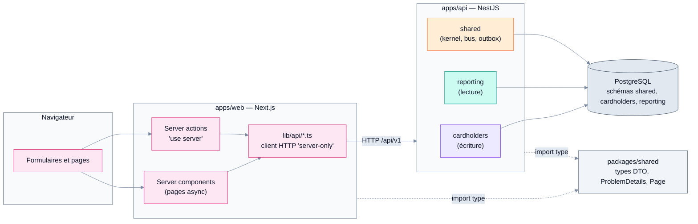
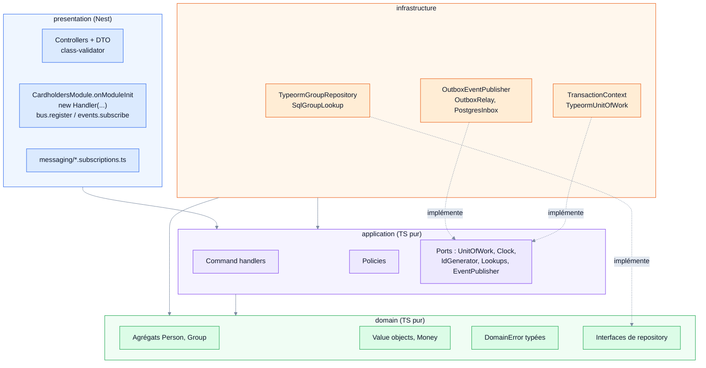
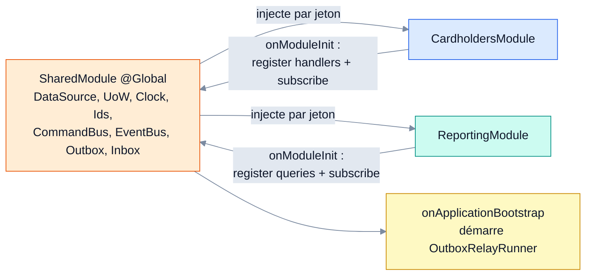
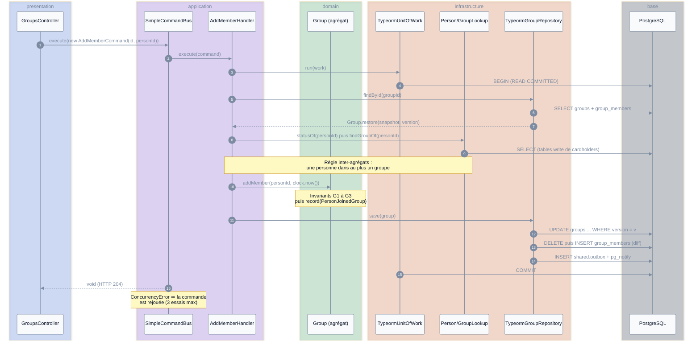
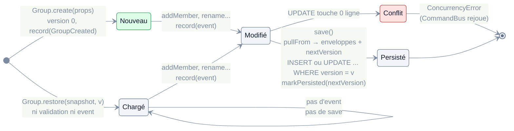
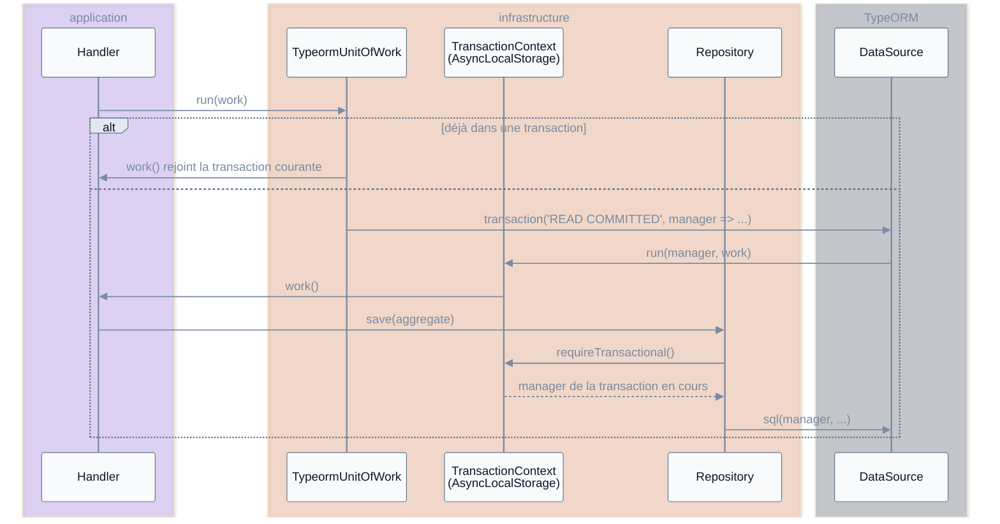
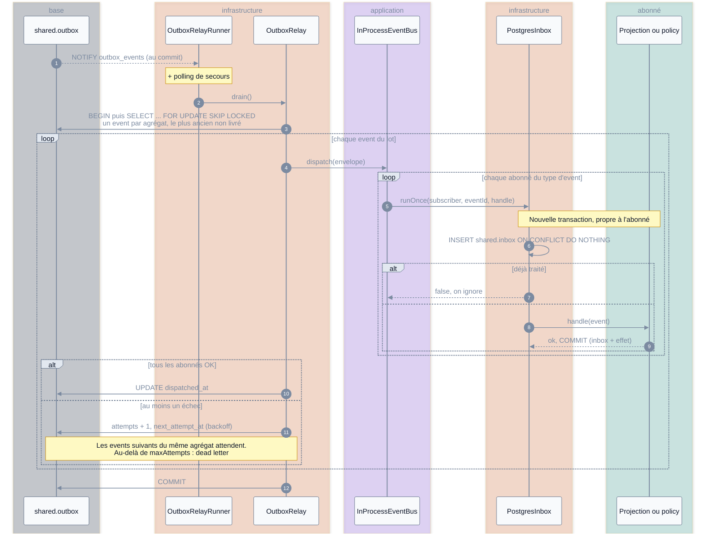
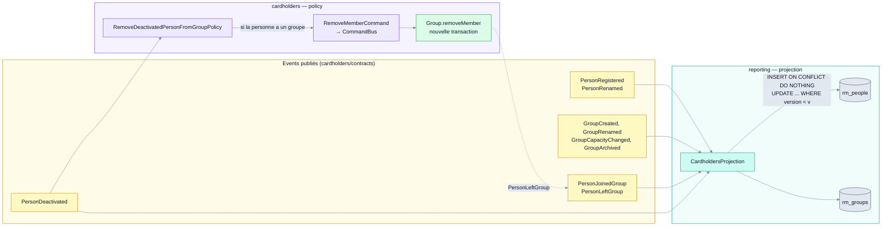
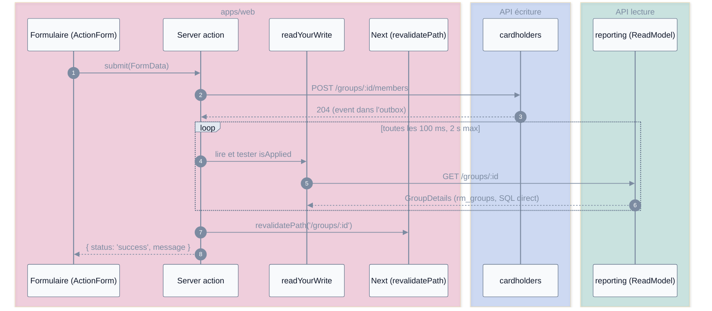
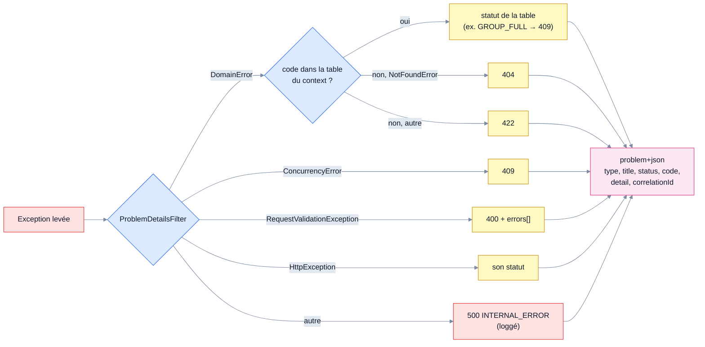

# Visite guidée de l'implémentation (état M1)

Ce document décrit **le code tel qu'il est** à la fin de M1 (Cardholders + Reporting), en suivant le trajet d'une requête. Il ne remplace pas les specs : en cas d'écart, [overview.md](overview.md), [cqrs.md](cqrs.md), [events-and-messaging.md](events-and-messaging.md) et [persistence.md](persistence.md) font foi.

Chemins de code relatifs à `apps/api/src/` sauf mention contraire.

**Légende des couleurs** (identique dans tous les schémas) :

| Couleur | Signification |
|---|---|
| Rose | front (`apps/web`) |
| Bleu | presentation (controllers, modules Nest) |
| Violet | application (handlers, bus, policies, ports) |
| Vert | domain (agrégats, VO, erreurs) |
| Orange | infrastructure (SQL, outbox, inbox, transactions) |
| Turquoise | lecture (reporting, read models) |
| Jaune | events |
| Gris | base de données |
| Rouge | erreurs, conflits |

---

## 1. Le monorepo



- **pnpm workspaces** : un dépôt, trois paquets. `packages/shared` ne contient que des types, effacés à la compilation.
- **`pnpm arch`** (dependency-cruiser, `apps/api/.dependency-cruiser.cjs`) fait échouer le build si une règle d'architecture est violée.

---

## 2. Couches et composition root



**Pourquoi des `Symbol` ?** Une `interface` TypeScript n'existe plus à l'exécution : Nest ne peut pas s'en servir comme clé d'injection. Chaque port exporte donc l'interface **et** un jeton du même nom :

```ts
export interface PersonRepository { findById(...); save(...); }
export const PERSON_REPOSITORY = Symbol('PersonRepository');
```



Les handlers sont construits à la main dans `onModuleInit` ([cardholders.module.ts](../../apps/api/src/cardholders/presentation/cardholders.module.ts)) : ils ne portent aucun décorateur Nest. Le relais ne démarre qu'au bootstrap, une fois **tous** les abonnés inscrits ([shared.module.ts](../../apps/api/src/shared/presentation/shared.module.ts)).

---

## 3. Écriture : `POST /groups/:id/members`



- Une **seule transaction** et un **seul agrégat** modifié. L'event est écrit dans l'outbox avec la même transaction : il n'existe que si l'écriture est commitée.
- La contrainte unique `group_members_person_unique` garantit en base la règle « un seul groupe » même en cas d'accès concurrent. Le repository la traduit en `PersonAlreadyInAGroupError` (`isUniqueViolation`).

Code : [group.handlers.ts](../../apps/api/src/cardholders/application/commands/group.handlers.ts), [group.aggregate.ts](../../apps/api/src/cardholders/domain/group/group.aggregate.ts), [typeorm-group.repository.ts](../../apps/api/src/cardholders/infrastructure/persistence/typeorm-group.repository.ts).

---

## 4. Cycle de vie d'un agrégat et versions



- `version` = verrou optimiste. `nextVersion = version + nombre d'events` (au moins 1). Chaque enveloppe reçoit `aggregateVersion = version + rang`.
- Le domaine ne connaît ni horloge, ni ids, ni corrélation : c'est [`EventEnvelopeFactory`](../../apps/api/src/shared/application/event-envelope.ts) qui les ajoute.

---

## 5. La transaction implicite (AsyncLocalStorage)

Node n'a qu'un thread, donc pas de `ThreadLocal`. `AsyncLocalStorage` en est l'équivalent : une valeur qui suit toute la chaîne d'`await` lancée depuis `storage.run(valeur, fn)`.



Les repositories participent à la transaction **sans la recevoir en paramètre**. Le même mécanisme transporte le `correlationId` (`AsyncLocalCorrelationContext`).

> Node reste concurrent : deux requêtes s'entremêlent à chaque `await`. Le verrou optimiste et les contraintes uniques restent donc nécessaires.

Code : [transaction-context.ts](../../apps/api/src/shared/infrastructure/database/transaction-context.ts), [typeorm-unit-of-work.ts](../../apps/api/src/shared/infrastructure/database/typeorm-unit-of-work.ts).

---

## 6. Asynchrone : outbox → relais → bus → inbox



| Garantie | Mécanisme |
|---|---|
| L'event existe ⇔ l'écriture est commitée | INSERT outbox dans la transaction métier |
| Livraison au moins une fois | relais + reprise avec backoff |
| Effet une seule fois par abonné | inbox `(subscriber, event_id)` dans la transaction de l'abonné |
| Ordre par agrégat | `NOT EXISTS` sur les events antérieurs non livrés |
| Plusieurs relais possibles | `FOR UPDATE SKIP LOCKED` |
| Traçabilité | `correlationId` conservé, `causationId` = id de l'event déclencheur |

Code : [outbox-event-publisher.ts](../../apps/api/src/shared/infrastructure/outbox/outbox-event-publisher.ts), [outbox-relay.ts](../../apps/api/src/shared/infrastructure/outbox/outbox-relay.ts), [event-bus.ts](../../apps/api/src/shared/application/event-bus.ts), [postgres-inbox.ts](../../apps/api/src/shared/infrastructure/inbox/postgres-inbox.ts).

---

## 7. Les abonnés



- **Projection** : idempotente et versionnée. Un event rejoué ou en retard ne peut pas écraser un état plus récent.
- **Policy** : la désactivation d'une `Person` ne modifie pas le `Group` dans la même transaction. Elle publie un event, et la policy envoie une commande qui modifie le `Group` dans **sa propre** transaction (une transaction = un agrégat).
- Un context n'importe d'un autre que ses `contracts/` : les types de payload `*V1`.

---

## 8. Lecture et front (CQRS, cohérence éventuelle)



- Les **lectures** ne passent jamais par le domaine : `SqlCardholdersReadModel` interroge `rm_*`, avec une pagination par curseur ([pagination.ts](../../apps/api/src/reporting/application/pagination.ts)).
- `readYourWrite` ([consistency.ts](../../apps/web/lib/api/consistency.ts)) ne lève pas d'erreur au timeout : la page affiche le dernier état connu.
- `import 'server-only'` dans `apps/web/lib/api/server.ts` : le build échoue si le client HTTP se retrouve dans le bundle du navigateur.

---

## 9. Les erreurs → `application/problem+json`



Chaque context enregistre sa table dans `onModuleInit` via `registerDomainErrorStatuses()` ([cardholders-error-statuses.ts](../../apps/api/src/cardholders/presentation/http/cardholders-error-statuses.ts)). Le front lit le `code` stable pour afficher un message.

---

## 10. Ordre de lecture du code

1. `shared/domain/` : `AggregateRoot`, `ValueObject`, `Money`, `DomainError`, `Brand`.
2. `cardholders/domain/group/group.aggregate.ts` et son `.spec.ts`.
3. `cardholders/application/commands/group.handlers.ts`.
4. `cardholders/infrastructure/persistence/typeorm-group.repository.ts`, puis `transaction-context.ts` et `typeorm-unit-of-work.ts`.
5. `shared/application/event-envelope.ts`, puis l'outbox, le relais, `event-bus.ts` et l'inbox.
6. `cardholders/presentation/cardholders.module.ts` et `shared/presentation/shared.module.ts`.
7. `reporting/` : projection, projection store, read model, query handlers.
8. `apps/web/` : `lib/api/`, `app/(app)/groups/actions.ts`, `page.tsx`.
