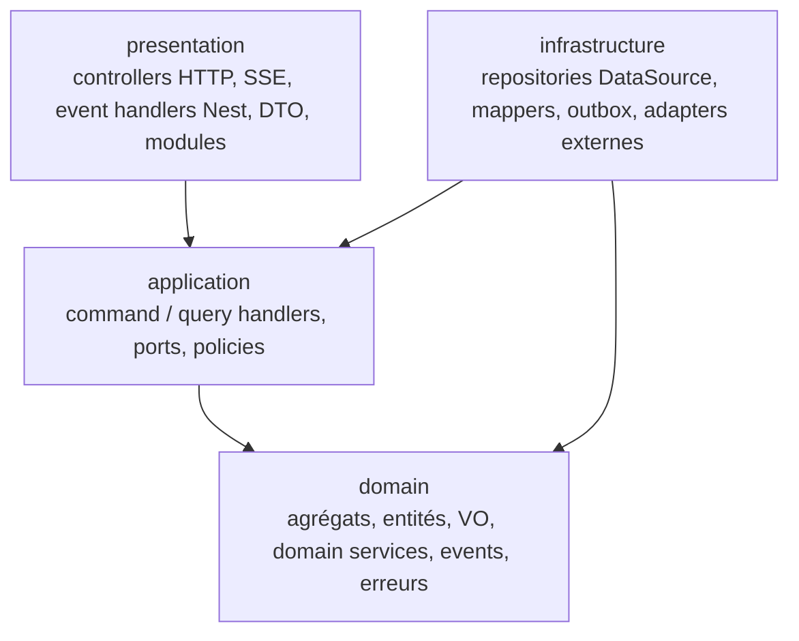
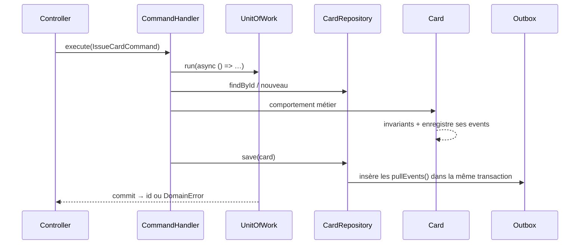

# 04 — Architecture : vue d'ensemble

## Couches (Clean Architecture)



| Couche | Contient | Peut dépendre de | Interdit |
|---|---|---|---|
| `domain` | agrégats, entités, value objects, domain services, domain events, `DomainError`, interfaces de repository | `shared/domain` | Nest, TypeORM, `class-validator`, I/O, `Date.now()` |
| `application` | `*.command.ts` + `*.handler.ts`, `*.query.ts` + handler, ports (`Clock`, `UnitOfWork`, lookups), policies (réactions aux events) | `domain` | Nest (sauf l'injection, voir plus bas), TypeORM |
| `infrastructure` | implémentations des repositories et des read models, mappers, schémas de tables, adapters (PAN, random, gateway), outbox | `application`, `domain`, TypeORM | logique métier |
| `presentation` | controllers REST, DTO + validation, mapping des erreurs HTTP, souscriptions aux events, modules Nest | `application` | accès direct aux repositories ou à la DB |

**Injection de dépendances.** Les handlers d'`application` sont des classes TS pures, qui reçoivent leurs ports par le constructeur. Le câblage Nest (`provide: CARD_REPOSITORY, useClass: TypeormCardRepository`) se fait dans le module du context (`presentation/<context>.module.ts`). Pour éviter tout décorateur Nest dans `application`, les handlers sont enregistrés via `useFactory`. Ils restent ainsi testables sans `TestingModule`.

## Arborescence d'un context

```
apps/api/src/
  shared/
    domain/            # AggregateRoot, Entity, ValueObject, Money, DomainEvent, DomainError, Result
    application/       # ports transverses : Clock, IdGenerator, UnitOfWork, EventPublisher, CommandBus, QueryBus
    infrastructure/    # DataSource, outbox, relais, bus in-process, SystemClock, Uuidv7Generator
    presentation/      # filtre d'erreurs → problem+json, pagination
  cards/
    domain/
      card.aggregate.ts
      hold.entity.ts
      value-objects/   # masked-pan.vo.ts, credit-limit.vo.ts…
      services/        # velocity-check.service.ts
      events/          # card-authorization-granted.event.ts…
      errors/
      card.repository.ts            # interface (port)
    application/
      commands/issue-card/          # issue-card.command.ts, issue-card.handler.ts, issue-card.handler.spec.ts
      queries/                      # requêtes propres au context si besoin
      policies/                     # authorize-on-card.policy.ts (réagit à TransactionRequested)
      ports/                        # cardholder-directory.port.ts, pan-generator.port.ts…
    infrastructure/
      persistence/                  # typeorm-card.repository.ts, card.mapper.ts, schemas
      adapters/                     # random-pan-generator.ts
    presentation/
      http/                         # cards.controller.ts, dto/
      messaging/                    # abonnements aux events → policies
      cards.module.ts
    contracts/                      # payloads d'events publiés (seul import autorisé depuis l'extérieur)
```

## Flux d'une commande



## Principes SOLID appliqués

- **S** : un handler par cas d'usage, un mapper par agrégat.
- **O** : on ajoute un scénario de simulation en implémentant `ScenarioStrategy`, sans modifier le générateur.
- **L** : les fakes in-memory des repositories respectent le même contrat que les implémentations TypeORM. Une suite de tests de contrat commune tourne sur les deux.
- **I** : ports étroits (`CardholderDirectory.isActive`), pas de repository « fourre-tout ».
- **D** : le domaine et l'application définissent les interfaces, et l'infrastructure les implémente.

## Pour aller plus loin

- [ports-and-adapters.md](ports-and-adapters.md)
- [cqrs.md](cqrs.md)
- [events-and-messaging.md](events-and-messaging.md)
- [persistence.md](persistence.md)
